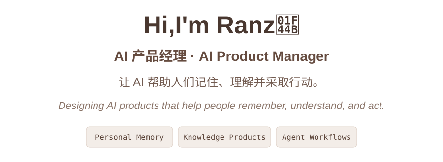

  

---

## About me

我关注 AI 如何从一次性的问答工具，变成能够理解上下文、沉淀知识并长期协作的产品。

> AI Product Manager exploring personal memory systems, knowledge products, and human-agent collaboration. I turn ambiguous product problems into structured workflows, testable prototypes, and reusable product methods.

目前主要探索四个方向：

- **个人记忆**：让用户能够持续积累、调用、修正和删除自己的记忆，同时保留清晰的隐私边界。
- **知识产品**：把碎片信息转化为可学习、可检索、可复用的知识资产。
- **Agent 工作流**：将复杂任务拆解为边界明确、结果可验证的智能体协作流程。
- **多 Agent 人机协同办公**：探索人在多智能体系统中的任务编排、过程干预、结果评审与责任追溯。

## Current focus

### [Personal Memory Lab](https://github.com/Ranz-Feng/personal-memory-lab) `Public prototype`

围绕个人记忆产品完成了多轮实验、方案分析与产品规划，相关能力已在实际产品中落地。现已将脱敏后的记忆闭环整理为可交互公开原型：

`Capture` → `Extract` → `Organize` → `Recall` → `Apply` → `Update / Forget`

[在线体验](https://ranz-feng.github.io/personal-memory-lab/) · [源码](https://github.com/Ranz-Feng/personal-memory-lab)

- 研究画像、对话与行为信息的分层组织方式。
- 设计记忆查看、编辑、删除和调用提示等用户控制机制。
- 关注提取、召回与应用效果的分层评测，避免只用一个总分掩盖问题。
- 平衡个性化效果、响应速度、推理成本与隐私安全。

### Product-Agent `Public prototype in progress`

独立开发的多 Agent 人机协同办公原型。通过明确输入、输出、职责边界和验收标准，让 Agent 参与客研、需求分析、方案设计、评审与需求管理，同时保留人工确认和主智能体质检。

## Selected projects

### [AI Knowledge Cards](https://github.com/Ranz-Feng/knowledge-cards)

面向 AI 产品经理的交互式术语学习工具。结合每日学习、间隔复习、相似概念对比和来源追溯，把“知道一个词”变成“理解它为什么与产品有关”。

[在线体验](https://ranz-feng.github.io/knowledge-cards/) · `HTML` · `CSS` · `JavaScript`

### [Product Manager Resume Skill](https://github.com/Ranz-Feng/product-manager-resume-skill)

用于优化中文产品经理与 AI 产品经理简历的 Codex Skill。重点处理项目叙事、指标可信度、职责边界、两页 A4 排版和打印验证。

`Codex Skill` · `Product Storytelling` · `Visual QA`

### [WeChat Article Viewer](https://github.com/Ranz-Feng/wechat-article-viewer)

用于读取和整理公开微信公众号文章的 OpenClaw Skill，通过浏览器渲染提取正文，支持后续总结、信息提取与多篇内容对比。

`OpenClaw Skill` · `Browser Automation` · `Content Processing`

## Product principles

- **先解决真实问题**：功能和模型都服务于用户任务，而不是技术陈列。
- **让结果可以验证**：为生成内容保留来源、评测口径和问题定位路径。
- **让用户保持控制**：尤其在个人记忆与自动化场景中，默认重视隐私、透明度和可撤销性。
- **把方法变成工具**：用可运行的原型、Skill 和文档沉淀产品思考。

---

**Building in public, one useful product at a time.**

